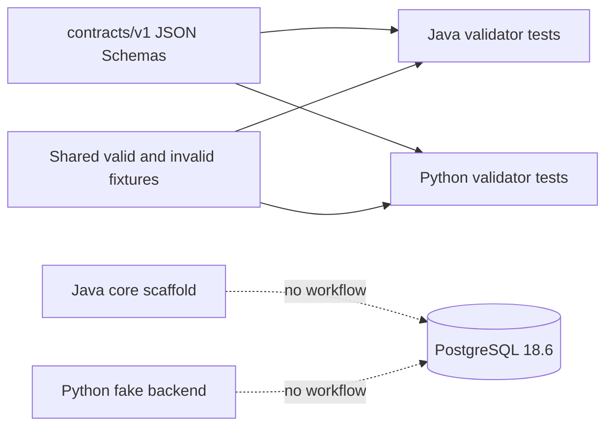

# Milestone 1 Architecture

Milestone 1 adds one static, versioned contract boundary. PostgreSQL remains the sole running
Compose service. The Java and Python applications remain independent scaffolds; both validate
the same corpus but no cross-process workflow exists.

## Boundaries

- `contracts/v1` is authoritative; runtime-specific classes do not redefine payload models.
- The schemas use Draft 2020-12, reject undeclared fields, and encode portable semantic
  invariants with conditional validation.
- PostgreSQL is prepared as the future durable source of truth, but still contains only the
  Milestone 0 Flyway baseline metadata.
- The fake backend is a deterministic test seam, not an LLM, extraction system, or trading strategy.
- No HTTP/domain API is exposed. Spring Boot runs as a non-web application when started manually.
- Broker, market-data, signal, risk, portfolio, execution, queue, order, ingestion, persistence,
  and model-runtime code are intentionally absent.
