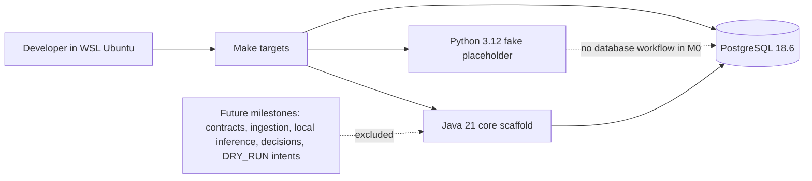

# Milestone 0 Architecture

Milestone 0 establishes the repository boundary only. PostgreSQL is the sole running service in Compose. The Java and Python applications are independent scaffolds; neither consumes nor produces trading-domain data.

## Boundaries

- PostgreSQL is prepared as the future durable source of truth, but Milestone 0 contains only Flyway baseline metadata.
- The fake backend is a deterministic test seam, not an LLM, extraction system, or trading strategy.
- No HTTP/domain API is exposed. Spring Boot runs as a non-web application when started manually.
- `contracts/`, `research/`, and `tests/fixtures/` are reserved for future milestones. Cross-language schemas begin in Milestone 1.
- Broker, market-data, risk, portfolio, execution, queue, order, and model-runtime code are intentionally absent.
