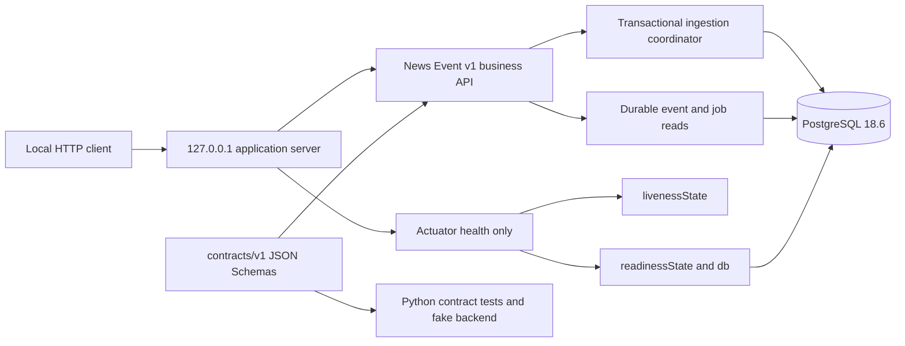

# M3A3 Architecture

The Java 21 modular monolith owns transactional news ingestion and immutable PostgreSQL revisions.
The Python 3.12 worker remains an independent scaffold; there is no cross-process workflow or worker
execution. PostgreSQL 18.6 is the sole Compose service. ADRs 0007–0010 record persistence, admission,
the loopback HTTP business API, and durable lifecycle schema decisions.

## Boundaries

- `contracts/v1` remains the authoritative cross-language boundary. Closed Draft 2020-12 schemas,
  portable semantic invariants, and the shared corpus are unchanged.
- Ingestion resolves immutable revision identity before freshness or capacity policy. Item locks
  serialize revision ordering; the durable NEWS_INFERENCE mutex serializes pending admission.
  Supersession, replacement insertion, and latest-pointer updates share one transaction.
- News admission is immutable (`QUEUED` or `OUT_OF_ORDER`); the schema supports all seven M3A job states.
  M3A1 supplies ingestion creation/supersession; M3A2 adds Java-only claim/renew/fail/recover;
  M3A3 adds validated completion, replay, and eligible-result reads. Business reads reconstruct
  state from PostgreSQL, not controller memory.
- Flyway V1/V2 are unchanged; V3 adds lifecycle fields, constraints, indexes and immutable results.
  `platform_metadata.milestone=3A` identifies schema support, not completed lifecycle operations.
  The complete approved behavior is recorded in [the M3A design reference](m3a-design.md).
- Ingestion uses item -> queue mutex -> predecessor job locks and credits a capacity slot only
  for a PENDING predecessor. It revokes nonterminal ownership on successful supersession;
  terminal jobs stay unchanged. Positive assignment limits and approved backend names are
  snapshotted per job. Reads expose current status without ownership or assignment metadata.
- All HTTP routes share one server bound exactly to `127.0.0.1`. External binding and separate
  management-listener configuration fail startup; the existing `-1` management-port opt-out remains.
- Actuator exposes only `/actuator/health` and its liveness/readiness groups. Liveness checks only
  application liveness; readiness additionally checks PostgreSQL. All health details and components
  are hidden. Discovery, other Actuator endpoints, and JMX exposure are disabled.
- Acceptance tests use isolated PostgreSQL Testcontainers and real ephemeral-port loopback HTTP.
  Database access denial is restored through resource cleanup. Only post-restoration readiness may
  poll with a deadline. Restart coverage closes one complete context before starting another against
  the same live database and schema, comparing explicitly ordered durable rows and stable metadata.
- The fake backend is a deterministic test seam. Worker endpoints, inference execution, model
  integration, Redis, broker submission, signals, risk, portfolio behavior, orders, and external AI
  access remain absent.

## Java lifecycle transactions

The public lifecycle service rejects ambient transactions and owns READ COMMITTED mutation boundaries.
Candidate discovery takes no job locks. Each mutation locks one item, then the durable queue mutex,
then the job; claim/recovery use SKIP LOCKED on item rows. Each recovery candidate has its own
transaction, with no item lock retained across candidates. Database decision time is sampled after
locking and preparation on the same connection. The ingestion Clock is unchanged.

Claim returns an assignment only after commit; assignment number and a fresh token fence renew/fail.
Recovery prioritizes revision obsolescence, news expiry, then lease expiry/exhaustion. Recoverable work
waits without ownership, and requeue uses the same exact pending-capacity mutex as ingestion.
A recovery exception records earlier committed progress; no outer transaction rolls those commits back.

Recovery's two phases share one candidate budget. A newly interrupted job can consume a cleanup slot
and a later requeue slot in one invocation. Claim adds its own bounded PENDING candidate list after
one recovery pass. NoWork is local to that call. The budget bounds work, while two-second lock and
five-second statement timeouts apply individually and do not impose an overall call deadline.
No scheduler, startup sweep, automatic retry framework, or read-triggered mutation is installed.

## M3A3 result boundary

Completion prepares strict JSON, decoded Unicode representability, and cached authoritative schema
validation outside locks. Under the established mutation locks it resolves historical replay first,
then fences current ownership, prepares provenance checks, and samples database time before the
guarded decision. Invalid live-owner output fails terminally; stale output cannot fail a replacement.
Insertion and success share one commit. Accepted assignment/token/time are server metadata outside
the payload; generated_at and model claims confer no authority.

Replay compares immutable JSONB only after matching accepting credentials and successful preparation.
Malformed, schema-invalid, or unrepresentable historical retries conflict without conversion.
Receipts survive expiry, supersession, and fully closed application contexts. Execution is not
claimed to be exactly once.

Current eligible-result reads use a separate read-only REPEATABLE READ boundary. An explicit
pg_current_snapshot() establishes the snapshot before lifecycle time is sampled. A joined latest
revision/SUCCEEDED/result lookup uses that decision instant, without locks, recovery, or historical
fallback. No new schema, direct dependency, or HTTP representation is introduced.
